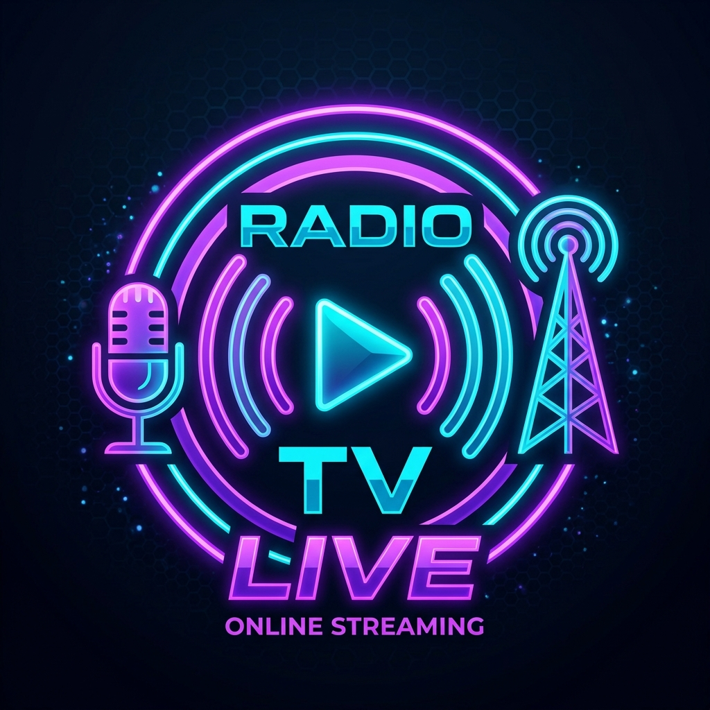

# 🎙️ Radio TV Online

> Plataforma profesional de radio y televisión online. Transmitís en vivo, tus oyentes escuchan desde la web. Chat en tiempo real, panel del locutor protegido con contraseña, estadísticas en vivo.



---

## 🚀 Características

- 🎵 **Reproductor de stream** compatible con Icecast, Shoutcast, YouTube Live y más
- 🔴 **Indicador EN VIVO** en tiempo real
- 💬 **Chat de oyentes** en tiempo real (Supabase Realtime)
- 🎙️ **Panel del locutor** protegido con email + contraseña
- 📊 **Estadísticas** de oyentes y actividad
- 🎵 **Ahora Suena** — metadata actualizable desde el panel
- 📱 **100% Responsive** — funciona en celular, tablet y desktop
- 🌙 **Dark mode premium** con glassmorphism y animaciones

---

## 📋 Uso en modo DEMO (sin Supabase)

Podés abrir `index.html` directo en el navegador **sin configurar nada**. Funciona en modo demo con datos de prueba.

- Para entrar al panel del locutor: usar contraseña **`radio2024`** (cualquier email)
- El chat funciona localmente en la misma sesión

---

## ⚙️ Configuración con Supabase

### 1. Crear cuenta en Supabase
1. Ir a [supabase.com](https://supabase.com) → Crear cuenta gratuita
2. Crear un **nuevo proyecto**
3. Ir a **Project Settings → API** y copiar:
   - `Project URL`
   - `anon public key`

### 2. Configurar las credenciales
Abrir `js/supabase.js` y reemplazar:

```js
const SUPABASE_URL = 'https://TU_PROYECTO.supabase.co';
const SUPABASE_ANON_KEY = 'TU_ANON_KEY_AQUI';
```

### 3. Crear las tablas
1. En Supabase ir a **SQL Editor**
2. Copiar y pegar el contenido de `supabase_setup.sql`
3. Ejecutar

### 4. Crear usuario locutor
1. En Supabase ir a **Authentication → Users → Add User**
2. Email: el que quieras (ej: `locutor@miradio.com`)
3. Password: la contraseña para el panel

---

## 🌐 Despliegue en GitHub Pages

1. Subir todos los archivos a un repositorio de GitHub
2. Ir a **Settings → Pages**
3. Seleccionar rama `main` y carpeta `/root`
4. En unos minutos tenés la URL pública: `https://tuusuario.github.io/radio-tv-online/`

---

## 📻 Conectar tu stream de audio

1. Entrar al **Panel del Locutor** (`broadcast.html`)
2. Ir a la sección **Transmisión**
3. Pegar la URL de tu stream:
   - **Icecast**: `http://servidor:8000/stream`
   - **Shoutcast**: `http://servidor:8000/;stream`
   - **YouTube**: usar embed URL del live
4. Hacer click en **"Ir al Aire"**

---

## 📂 Estructura de archivos

```
radio-tv-online/
├── index.html          # Página pública del oyente
├── broadcast.html      # Panel del locutor (protegido)
├── supabase_setup.sql  # Script de configuración de base de datos
├── css/
│   └── style.css       # Estilos del sistema de diseño
├── js/
│   ├── supabase.js     # Configuración y helpers de Supabase
│   ├── app.js          # Lógica del reproductor público
│   └── broadcast.js    # Lógica del panel de transmisión
└── assets/
    └── logo.png        # Logo de la radio
```

---

## 💰 Licencia Comercial

Este sistema fue desarrollado para reventa. Cada cliente recibe:
- ✅ Archivos del proyecto personalizados
- ✅ Configuración de Supabase
- ✅ Instrucciones de uso
- ✅ Subida a GitHub Pages

**Precio**: $50.000 ARS (setup) + $25.000 ARS/mes (mantenimiento)

---

## 🛠️ Soporte técnico

Ante cualquier consulta o problema técnico, contactar al desarrollador.

---

*Desarrollado con ❤️ para radios online argentinas*
